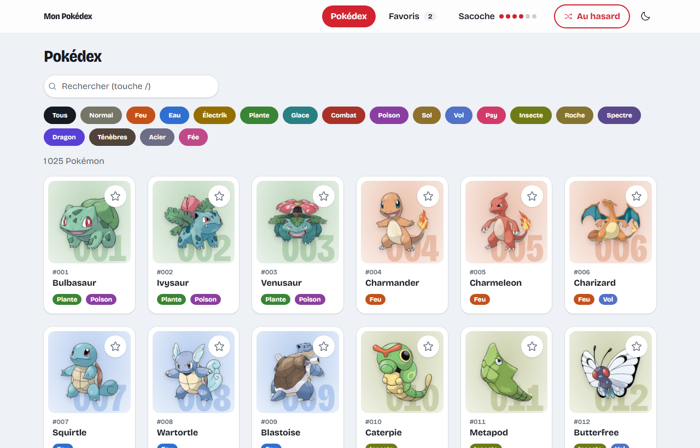
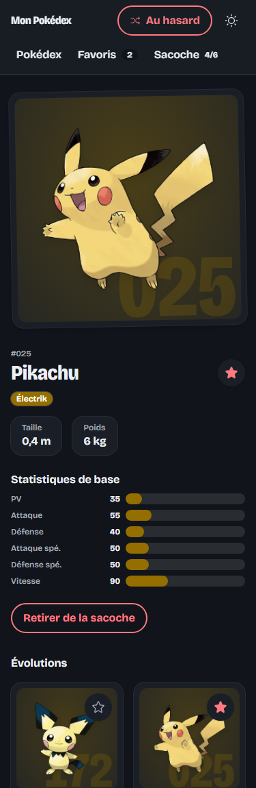
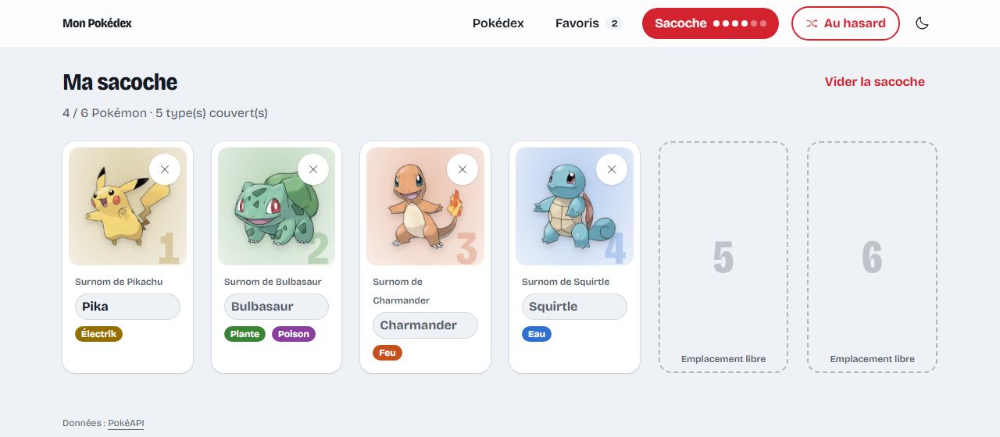

# Mon Pokédex

Application web qui présente les 1 025 Pokémon à partir de la [PokéAPI](https://pokeapi.co),
construite en suivant le cours « Pokédex — 35 heures » (Next.js, React, TypeScript, Tailwind CSS,
Zustand).



## Fonctionnalités

- **Grille paginée** : 24 Pokémon par page, illustration officielle, numéro `#025`, nom et types
  en couleur ; chaque carte prend la teinte de son type principal.
- **Fiche détaillée** (`/pokemon/pikachu`) : grande illustration, taille, poids, statistiques
  de base en barres, chaîne d'évolution complète (branches comprises). Les 151 premières fiches
  sont construites à l'avance.
- **Recherche et filtre par type**, rangés dans l'adresse (`/?q=pi&type=electric&page=2`) :
  le lien se partage et le bouton « Précédent » fonctionne. Touche `/` pour aller dans la
  recherche.
- **Favoris** (étoile sur chaque carte et chaque fiche) et **sacoche** de 6 Pokémon au plus, sans
  doublon, avec un surnom pour chacun ; les deux sont conservés dans le navigateur.
- **Bouton « Au hasard »** (point d'API `/api/aleatoire`), **thème sombre** mémorisé, interface
  utilisable entièrement au clavier, états de chargement, d'erreur et page 404 soignés.

| Fiche (thème sombre, téléphone) | Sacoche |
|---|---|
|  |  |

## Lancer le projet

Prérequis : Node.js 20 ou plus récent (LTS), npm.

```bash
npm install
npm run dev      # http://localhost:3000
```

Autres commandes :

```bash
npm run lint     # vérification du code (ESLint)
npm test         # tests des fonctions pures (Vitest)
npm run build    # version de production
npm start        # lance la version de production en local
```

Aucune variable d'environnement n'est nécessaire : la PokéAPI est publique et sans clé.

## Déploiement

Le projet est prévu pour [Vercel](https://vercel.com) : importer le dépôt GitHub dans Vercel,
garder les réglages proposés pour Next.js, puis chaque `git push` redéploie le site.

Adresse publique : *à compléter après le déploiement.*

## Structure

```text
app/          pages et layouts (App Router), Route Handler app/api/aleatoire
components/   composants (serveur par défaut, client seulement si nécessaire)
hooks/        hooks personnalisés (usePokemons, useRappelTemporise, useRaccourci)
lib/          accès aux données (pokeapi.ts, conversion.ts), table des types, validation de l'adresse
stores/       stores Zustand (favoris, sacoche)
types/        types TypeScript (type de l'API et type de l'application)
docs/         justification de chaque choix, chapitre par chapitre
```

## Documentation des choix

Chaque choix est expliqué et relié au chapitre du cours qu'il applique, avec les alternatives
écartées, dans [`docs/`](docs/) :

| Chapitre | Document |
|---|---|
| 0 — Démarrage | [docs/00-demarrage.md](docs/00-demarrage.md) |
| 1 — Rappels web | [docs/01-rappels-web.md](docs/01-rappels-web.md) |
| 2 — JavaScript moderne | [docs/02-javascript-moderne.md](docs/02-javascript-moderne.md) |
| 3 — TypeScript | [docs/03-typescript.md](docs/03-typescript.md) |
| 4 — React | [docs/04-react.md](docs/04-react.md) |
| 5 — Tailwind CSS et interface | [docs/05-tailwind-interface.md](docs/05-tailwind-interface.md) |
| 6 — Next.js | [docs/06-nextjs.md](docs/06-nextjs.md) |
| 7 — Appels API | [docs/07-appels-api.md](docs/07-appels-api.md) |
| 8 — Routes dynamiques | [docs/08-routes-dynamiques.md](docs/08-routes-dynamiques.md) |
| 9 — Interactivité avancée | [docs/09-interactivite-avancee.md](docs/09-interactivite-avancee.md) |
| 10 — Les hooks en profondeur | [docs/10-hooks.md](docs/10-hooks.md) |
| 11 — Finitions | [docs/11-finitions.md](docs/11-finitions.md) |

## Crédits

- Données et illustrations : [PokéAPI](https://pokeapi.co). Pokémon est une marque de Nintendo,
  Creatures et Game Freak ; ce projet est un exercice de cours sans but commercial.
- Icônes : [Phosphor Icons](https://phosphoricons.com) (licence MIT), tracés copiés dans
  `components/Icone.tsx`.
- Police : Bricolage Grotesque (Google Fonts, licence SIL Open Font License), servie par
  `next/font`.
